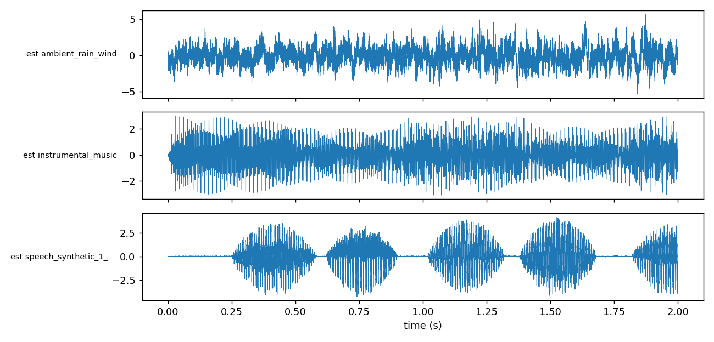
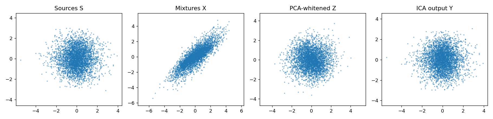
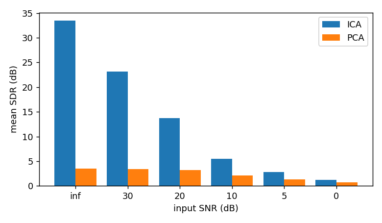

# Write-up: Unmixing Signals with ICA

## 1. Why ICA over PCA?

PCA makes the signals **uncorrelated**, using only second-order statistics (the covariance matrix). Uncorrelated is weaker than **independent**. Independence also constrains higher-order statistics. After PCA the data are only determined up to an unknown rotation, because any rotation of white data is still white. ICA uses higher-order statistics (here, non-Gaussianity) to pick the rotation that makes the outputs independent.

In my experiment PCA gave correlations of only 0.64 to 0.80 with the true sources (mean SDR 3.5 dB), while ICA reached 0.9996 to 0.9999 (mean SDR 33.4 dB).

## 2. What whitening does and why it simplifies ICA

Whitening applies `Z = D^(-1/2) Eᵀ X` (from the eigendecomposition of the covariance) so that `cov(Z) = I`. Then the mixing matrix in the whitened space is orthogonal, so the problem reduces from estimating a general n x n matrix to estimating a **rotation**. It also lets FastICA constrain each row `w` to unit norm and enforce independence between rows with a simple orthogonalization. `scatter_stages.png` shows this: mixtures are a skewed cloud, whitened data are a rotated square-like cloud, and the ICA output realigns with the axes.

## 3. Why non-Gaussianity enables separation, and the CLT link

By the **Central Limit Theorem**, a sum of independent variables is closer to Gaussian than the variables themselves. Each mixture is a sum of sources, so it is more Gaussian than any source. So we look for directions `w` where `wᵀz` is as **non-Gaussian** as possible, measured with kurtosis or negentropy (approximated by `logcosh`). Those directions correspond to the individual sources.

If the sources were Gaussian, every rotation would give equally Gaussian outputs, so no direction would be preferred and ICA would fail. My sources have measured excess kurtosis of 1.01 (ambient), -0.17 (music) and 1.83 (speech), so they are non-Gaussian enough, and the music is sub-Gaussian. `logcosh` copes with both signs.

## 4. How experiments and metrics were chosen

- **Mixing:** a random matrix with entries in [0.3, 1.0] and condition number below 20, so the problem is well posed.
- **Correlation:** a simple check of waveform similarity, taken in absolute value because ICA has a sign ambiguity.
- **SDR (dB):** `10 log10(|s|² / |s - ŝ|²)` measures the actual error energy. It needs the scale ambiguity fixed first, so each estimate is rescaled with a least-squares gain.
- **Permutation:** estimates come in arbitrary order, so I match them with the Hungarian algorithm on `|corr|`.
- **PCA baseline:** the whitened components, without the ICA rotation, scored the same way. This isolates what ICA adds.
- **SNR sweep:** I added white Gaussian sensor noise at 30, 20, 10, 5 and 0 dB. ICA stays far above PCA down to about 10 dB. At 0 dB both are poor, because noise at that level breaks the noiseless-mixing model.

## Results summary

| Condition | ICA mean SDR | PCA mean SDR |
|---|---|---|
| Noiseless | 33.4 dB | 3.5 dB |
| 20 dB SNR | 13.8 dB | 3.2 dB |
| 10 dB SNR | 5.5 dB | 2.1 dB |

## Limitations

- Instantaneous (non-convolutive) mixing and as many mixtures as sources. Real room recordings have delays and echoes, which need convolutive ICA.
- Results use a single random seed and synthetic mixing.
- FastICA is sensitive to noise, shown by the SNR sweep.